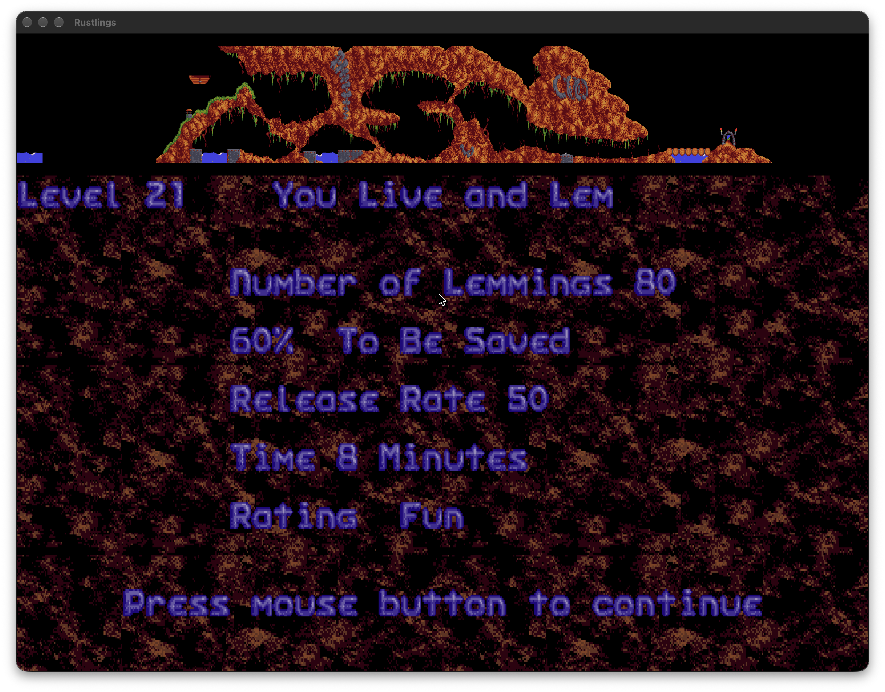
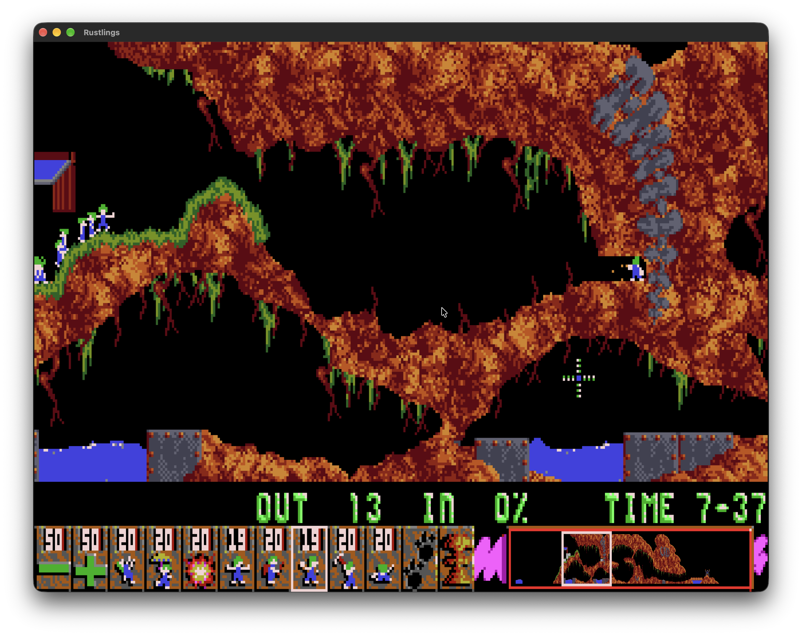
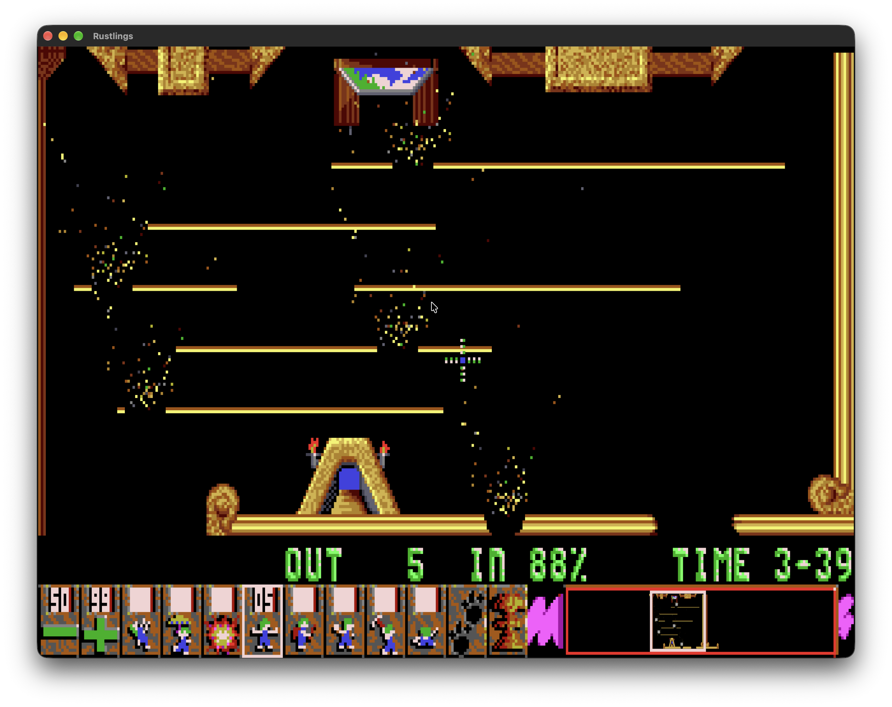

# What is this?

This is an in-progress replacement engine for the DOS game Lemmings. It is built
to act as a drop-in replacement for the original DOS executable with pixel-exact
physics and high-quality upscaled graphics rendered at the native screen refresh
rate.

At this point the gamme is fully playable. Still missing are

- The main menu
- Audio
- Winning --- the game currently wraps after the last level

Graphics make heavy use of GPU rendering. SDL software rendering works, but
expect a hefty CPU load without acceleration. With acceleration, CPU load is
minimal (as it should be for something that ran on a 80286 😛).

</img>
</img>
</img>

# Building

You need Rust, Cargo and SDL3 (optional) installed. Do

```
$ cargo build -r
```

in order to do an optimized build. The game builds and runs on MacOS, Linux and
Windows.

If you don't have SDL3 installed (looking at you, Windows), you can do

```
$ cargo build --features sdl3/build-from-source-static -r
```

to build and link SDL3 statically on-the-fly.

# Running

Just drop the binary next to the data files and start it. You can also point the
game to the data files via

```
$ ./target/release/rustlings <path to DOS files>
```

# Playing

Gameplay works just the same as it did in DOS, including most quirks and bugs
of the original. Without the main menu there currently is no way to enter level
codes, but you can use page up / page down on the briefing screen to cycle through
the levels.

## Keybindings:

'Meta' refers to any of ctrl / alt / command.

### All screens

- **meta enter**: toggle full screen
- **meta q**: quit game

### Briefing screen

- **Page down / up**: next / previous level
- **Enter / Space / Left click** launch current level

### Ingame

- **Left / right**: scroll (hold shift or right mouse button for fast scrolling)
- **1 -- 8**: switch skill
- \+ / - : change release rate
- **Shift**: hold to emulate right mouse button
- **Escape**: exit level early
- **p**: pause
- **meta space**: hold to run at 4x speed

### Debriefing screen

- **Enter / Space / Left click** Launch next level / retry current level

# References

- [File formats](https://www.camanis.net/lemmings/tools.php) on the Lemmings
  archive
- I use the [Lemmix](https://github.com/ericlangedijk/Lemmix) source as a
  reference for game physics (together with pixel-by-pixel comparisions against
  screen recordings from dosbox)
- Several details like the level code encoding are reverse engineered from the
  original DOS binary with [Ghidra](http://ghidra.net)

# License

This program is free software: you can redistribute it and/or modify it under
the terms of the GNU General Public License as published by the Free Software
Foundation, either version 3 of the License, or (at your option) any later
version.
